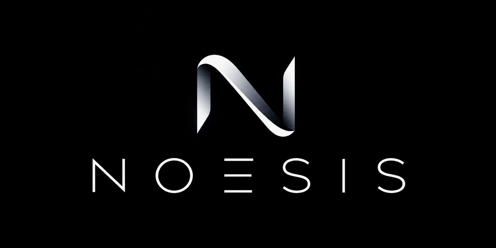

  

# Project NOESIS

**Experimental non-neural cognition research · Research Cradle v0.4.1**

NOESIS investigates cognitive mechanisms through small, observable experiments.
Its central coordinating component is the **Central Adaptive Cortex (CAC)**,
supported by specialized processing lobes. The name describes the intended
architecture; adaptive cognition has not been demonstrated.

The current Research Cradle is a local desktop testing environment for symbol
identification, exact comparison, and within-session retention. It does not use
pretrained language models or external AI APIs.

## Participate

You can help by discussing research methods, reviewing documented claims, proposing
experiments, and improving these public documents. Tester downloads are pending.
When a reviewed build becomes available, reproducible bug reports and independent
black-box experiments will be welcome too.

- [Tester guide and benchmark protocols](docs/TESTING.md)
- [Project wiki](https://github.com/z0mbi3jesus/project-noesis/wiki) · [Wiki source index](docs/WIKI.md)
- [Research status and limitations](docs/RESEARCH_STATUS.md)
- [Contribution guide](CONTRIBUTING.md)
- [Rights and licensing status](LICENSE.md)
- [Research-and-development participation scope](docs/PARTICIPATION_SCOPE.md)
- [Community conduct](CODE_OF_CONDUCT.md)
- [Privacy and experimental data](PRIVACY.md)
- [Research integrity](docs/RESEARCH_POLICY.md)
- [Release policy](docs/RELEASE_POLICY.md)
- [Report an issue](https://github.com/z0mbi3jesus/project-noesis/issues/new/choose)
- [Releases](https://github.com/z0mbi3jesus/project-noesis/releases)

**Tester downloads are currently on hold.** This repository package contains public
documentation, not the app or an installer. GitHub's automatic "Source code"
downloads contain this documentation only when it is published as a clean
public-only repository. Availability, supported systems, and distribution terms
will be stated in any future release. No public tester build is supplied here.

## Current experiments

| Benchmark | Input | What is investigated |
| --- | --- | --- |
| 001 | One uppercase ASCII letter, A–Z | Symbol distinction, exact comparison, and retention |
| 002 | One ASCII letter or digit, A–Z / a–z / 0–9 | Classification, case-sensitive comparison, and deeper encounter histories |

Each benchmark has an independent workspace and session. Processing uses explicit,
developer-supplied rules. `A` and `a` are distinct; `7` is a character, not an
arithmetic value. Unsupported submissions are rejected and remain traceable.

The implementation passed 47 automated tests and 15 functional cases during the
v0.4.1 development validation, including 100-, 500-, and 1,000-encounter headless
histories. These are developer-run checks, not independent scientific validation
or guarantees for another machine. Benchmark 002 remains under review.

## Participation and future licensing

Current authorization is limited to approved NOESIS research-and-development
participation as described in the [participation scope](docs/PARTICIPATION_SCOPE.md).
6th Level LLC retains rights in its project materials; participation does not
transfer ownership or grant a general implementation, distribution, or commercial
license. Contributor rights remain separate.

An open-source release may be considered when the theoretical CAC foundation is
more clearly defined and experimentally validated. It requires explicit project-lead
approval of both the released components and their license; it is not automatic or
promised. Benchmark success does not prove the entire architecture.

## Scientific boundaries

The current results demonstrate programmed symbol handling and retention. They
do **not** establish semantic understanding, generalized learning, autonomous
reasoning, consciousness, or independent cognition. Benchmark 003 has not begun.

The cradle displays recorded component contributions and evidence rather than
invented internal explanations. Its logs separate routine events, warnings and
recoverable failures, and detailed reports for application-ending crashes.

## Public repository scope

This public package is a documentation and participation hub. The implementation,
internal design notes, raw experiment data, and development history are not included
in the prepared public package. It is not an open-source implementation release.
Source-level review and rebuilding the app are unavailable from this package.

Participation does not require access to the implementation. Distribution terms
for future tester builds have not been selected; no binary release is authorized
by this documentation.

## Local data

The current application has no internet or external AI service capabilities.
Diagnostics are local; exports are shared only when you choose to attach them.
Exports can contain entered text, file paths, identifiers, and diagnostic details.
Review them before posting publicly. See [SECURITY.md](SECURITY.md) for sensitive
reporting guidance.
